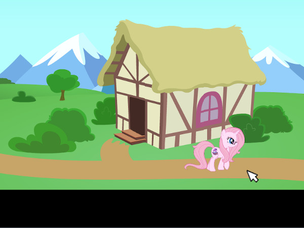
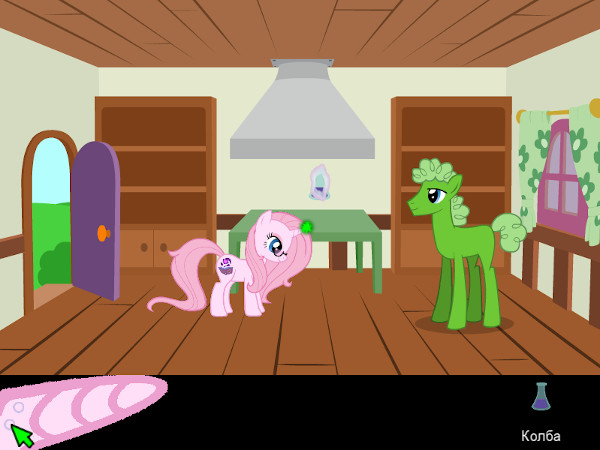

# NimeTravel / Путешествие Нимэ

NimeTravel is a quest game, based on self-made engine for Loom-like games, created using SFML and PascalScript.
The engine is written on Delphi, compatible with FreePascalCompiler.
The current version of the game contains only prologue of the story.

Путешествие Нимэ - игра-квест, в основе которого - сбор и применение не
предметов, а заклинаний (пример аналогичной игры - [Loom](https://en.wikipedia.org/wiki/Loom_(video_game))
Герой получает от окружающего мира заклинания, запоминает их и применяет на
других объектах для продвижения по сюжету игры.

 

**В настоящее время, игра находится в разработке.** Выпущен и доступен к загрузке завершенный пролог игры.
В нём создано 6 локаций, 2 заклинания и завязка сюжета.
Игра полностью свободна для загрузки и распространения, доступна в виде дистрибутивов и исходных кодов.
Движок написан на Delphi, совместим с FreePascalCompiler, использует 
[SFML](https://www.sfml-dev.org/) и [PascalScript](https://www.remobjects.com/ps.aspx)
